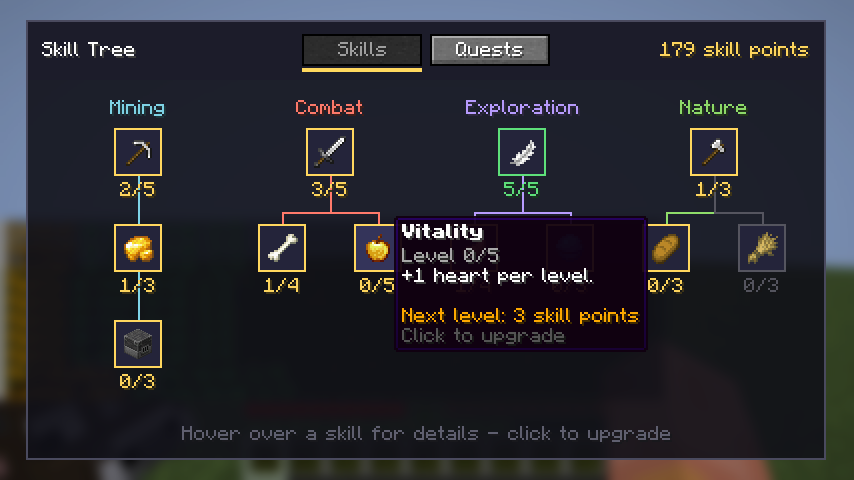
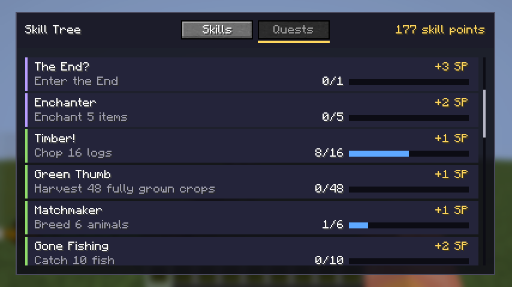

# Skill Tree

A Minecraft mod for [Fabric](https://fabricmc.net/) that adds a quest-based skill tree.
Complete quests, earn skill points and spend them on twelve skills in four branches.

| Skill tree (press **K**) | Quest log |
| --- | --- |
|  |  |

- **Minecraft** 1.21.11 · **Fabric Loader** 0.18.2+ · **Fabric API** · **Java** 21
- Works in singleplayer and on servers. The mod must be installed on both the server and the client.
- English and Dutch translations.

## How it works

1. **Play.** Quests track what you do: mining, fighting, travelling, farming.
   Nothing has to be accepted first; every unlocked quest counts automatically.
2. **Earn.** A finished quest pays skill points, and sometimes experience or items.
   Each branch ends in a repeatable quest, so points never run out.
3. **Spend.** Press **K** and click a skill to raise it one level.
   A skill unlocks once the skill above it is high enough.

### Skills

| Branch | Skill | Levels | Cost per level | Requires | Effect per level |
| --- | --- | :-: | :-: | --- | --- |
| Mining | Mining | 5 | 2 | - | +10% mining speed |
| | Prospector | 3 | 2 | Mining 2 | 15% chance that an ore drops twice |
| | Smelter | 3 | 2 | Prospector 1 | 33% chance that an ore drops already smelted |
| Combat | Combat | 5 | 2 | - | +1 attack damage |
| | Looter | 4 | 2 | Combat 2 | 15% chance of double mob loot, bonus experience per monster |
| | Vitality | 5 | 3 | Combat 3 | +1 heart |
| Exploration | Agility | 5 | 2 | - | +5% movement speed |
| | Acrobatics | 4 | 2 | Agility 2 | -20% fall damage, +1 block safe fall height |
| | Diver | 3 | 2 | Agility 3 | Longer breath and faster movement under water |
| Nature | Lumberjack | 3 | 2 | - | One chop fells the whole tree (16 / 48 / 128 logs). Sneak to switch it off |
| | Gourmet | 3 | 1 | Lumberjack 1 | Eating restores 1 extra hunger point |
| | Rancher | 3 | 1 | Lumberjack 2 | Bred animals are ready again 25% sooner |

The whole tree costs 91 skill points.

### Quests

There are 25 quests. Every branch has a chain that gets harder and pays more, for example:

| Quest | Objective | Reward |
| --- | --- | --- |
| First Dig | Mine 32 blocks of stone | 1 point |
| Ore Hunter | Mine 16 ores | 2 points |
| Deep Delver | Mine 64 ores | 3 points, 5 experience levels |
| Motherlode *(repeatable)* | Mine 100 ores | 2 points |
| Exterminator | Defeat 150 monsters | 3 points, 2 golden apples |
| Wither Slayer | Defeat the Wither | 5 points, 10 experience levels |
| Into the Nether | Enter the Nether | 2 points |

The full list is in [`DefaultQuests.java`](src/main/java/com/sarah/skilltree/domain/catalog/DefaultQuests.java).

### Commands

| Command | Who | What |
| --- | --- | --- |
| `/skilltree` | everyone | Show your points and skills |
| `/skilltree upgrade <skill>` | everyone | Raise a skill by one level |
| `/skilltree quests` | everyone | Show your active quests |
| `/skilltree admin addpoints <player> <amount>` | operators | Give skill points |
| `/skilltree admin reset <player>` | operators | Reset all skills and refund the points |

## Building and running

You need JDK 21. Gradle downloads everything else, including Minecraft.

```bash
./gradlew build        # compile, run the tests, create build/libs/skilltree-1.0.0.jar
./gradlew test         # run only the unit tests
./gradlew runClient    # start Minecraft with the mod
./gradlew runServer    # start a dedicated server with the mod
```

On Windows use `gradlew.bat` instead of `./gradlew`.

In IntelliJ IDEA, open the folder as a Gradle project. After the import, the run
configurations *Minecraft Client* and *Minecraft Server* appear automatically.

To install the mod in a normal game, put `build/libs/skilltree-1.0.0.jar` and the
[Fabric API](https://modrinth.com/mod/fabric-api) jar in the `mods` folder.

## Architecture

The code is split into three layers. A layer only talks to the layer directly below it.

```
┌──────────────────────────────────────────────────────────────────────┐
│ PRESENTATION   everything that touches Minecraft                     │
│   src/main    commands, game events, skill effects, network packets  │
│   src/client  key binding and the screen                             │
└───────────────────────────────┬──────────────────────────────────────┘
                 request DTO    │    ▲  response DTO
                                ▼    │
┌──────────────────────────────────────────────────────────────────────┐
│ DOMAIN         the rules, in plain Java (no Minecraft imports)       │
│   services     SkillService, QuestService, ProfileService            │
│   model        Skill, Quest, Objective, Reward, PlayerProfile        │
│   catalog      the skills and quests that ship with the mod          │
└───────────────────────────────┬──────────────────────────────────────┘
                                ▼
┌──────────────────────────────────────────────────────────────────────┐
│ PERSISTENCE    PlayerProfileRepository (interface)                   │
│                └ JsonPlayerProfileRepository: one JSON file a player │
└──────────────────────────────────────────────────────────────────────┘
```

```
com.sarah.skilltree
├── SkillTreeMod            entry point, creates and connects the objects
├── config                  SkillTreeConfig: every constant in one place
├── exception               the mod's own exceptions
├── domain
│   ├── model               entities and value objects
│   ├── catalog             skill and quest definitions
│   ├── dto.request         what the presentation layer asks
│   ├── dto.response        what the domain answers
│   └── service             entry points of the domain
├── persistence             repository interface and JSON implementation
├── presentation
│   ├── command             /skilltree
│   ├── controller          shared handling for commands and packets
│   ├── effect              what the skills do in the game
│   ├── event               game event listeners
│   ├── message             text for the player
│   ├── network             packets between server and client
│   └── watcher             once-per-second checks
└── client                  (src/client) key binding and screen
```

### Example: clicking a skill

1. `SkillTreeTab` (client) sends an `UpgradeSkillPayload` with only the skill id.
2. `ServerNetworking` receives it and calls `SkillController.upgrade`.
3. The controller builds an `UpgradeSkillRequest` and calls `SkillService.upgradeSkill`.
4. The service asks `PlayerProfile.upgradeSkill`, which checks the rules: maximum level,
   prerequisite, enough points. A broken rule throws one of the mod's exceptions.
5. The controller applies the new attributes, tells the player, and sends a
   `SkillTreeSyncPayload` back. On an exception it sends the translated error instead.
6. The screen redraws with the new data.

The `/skilltree upgrade` command enters at step 2, so the screen and the command cannot behave differently.

### Design decisions

**The server decides, the client only asks.** The client sends "upgrade this skill" and
nothing else. Points and levels exist only on the server, so a modified client cannot cheat.

**The domain does not know Minecraft.** No class in `domain` or `persistence` imports a
Minecraft class. That makes the rules testable in milliseconds without starting the game,
and a Minecraft update can only break the presentation layer.

**Rules live in the entity.** `PlayerProfile` protects its own data: it is impossible to
give a player a level above the maximum or negative points, whichever class tries.

**Quests are data.** A quest is an `Objective` (what, how often, optionally which target) plus
rewards, built with a builder. Adding a quest is one entry in `DefaultQuests`, no new code.

**Rewards are a sealed interface.** `Reward` permits exactly `SkillPointReward`,
`ExperienceReward` and `ItemReward`. A `switch` over a reward must handle all of them, so a
new kind of reward cannot be forgotten somewhere: the compiler refuses to build.

**Passive skills use Minecraft's attribute system.** Speed, health, damage, fall damage and
breath are attributes in the game. The mod sets one modifier per skill and the game does the
rest. A new passive skill is one line in `AttributeEffects`.

**Drop bonuses edit the loot, they do not replace it.** `LootEffects` changes the list of drops
after the game rolled it, so Prospector and Looter stack with Fortune and Looting.

**Statistics instead of extra hooks.** Fabric has no event for walking, breeding, fishing,
trading or enchanting, but Minecraft already counts them (the Statistics screen).
`StatisticWatcher` reads those counters once per second and reports the difference.
The mod therefore needs **no mixins**: it only uses public Fabric API, which keeps it
easy to update to new Minecraft versions.

**JSON instead of NBT.** Profiles are stored as `world/skilltree/<uuid>.json`. JSON is
readable, and the repository can be unit tested with a temporary folder. Files are written
to a temporary file first and then swapped in, so a crash cannot leave half a file. A damaged
file is renamed to `.corrupt` instead of being overwritten.

**No global state.** `SkillTreeMod` creates every object once and passes dependencies through
constructors. In singleplayer a new server starts for every world, so `ServiceProvider`
creates the services per server.

**Translated on the client.** The server sends translation keys, never finished sentences,
so every player sees the mod in their own language.

## Tests

```bash
./gradlew test
```

69 unit tests with JUnit 5 and Mockito cover the domain, the persistence layer and the
network packets:

| Test class | What it checks |
| --- | --- |
| `PlayerProfileTest` | upgrade rules, refunds, quest progress, repeatable quests |
| `SkillCatalogTest`, `DefaultCatalogsTest` | duplicate ids, missing prerequisites, cycles, balance of the shipped content |
| `SkillServiceTest`, `QuestServiceTest` | the services, with a mocked `ProfileService` |
| `ProfileServiceTest` | loading, caching and saving, with a mocked repository |
| `JsonPlayerProfileRepositoryTest` | reading and writing real files in a temporary folder, damaged files |
| `PayloadRoundTripTest` | a packet comes out of the network exactly as it went in |
| `LanguageFilesTest` | every skill and quest has an English and a Dutch translation |

GitHub Actions runs `./gradlew build` on every push ([workflow](.github/workflows/build.yml)).

## Known limitations

- Blocks placed by a player count for quests when mined again. Ores mined with Silk Touch are
  excluded from the drop bonuses for that reason, but quest progress is not protected.
- Travel quests count distance on foot (walking, sprinting, sneaking), not by boat, horse or elytra.
- The skill bonuses are stored on the player as attribute modifiers. Before removing the mod
  from a world, run `/skilltree admin reset <player>` so extra hearts do not stay behind.
- The mod is built for Minecraft 1.21.11. Other versions need a rebuild and possibly small changes
  in the presentation layer.

## License

[MIT](LICENSE)
